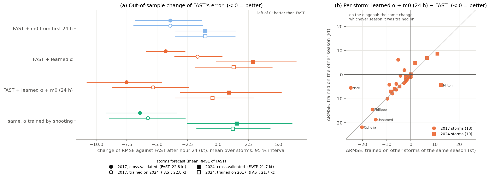
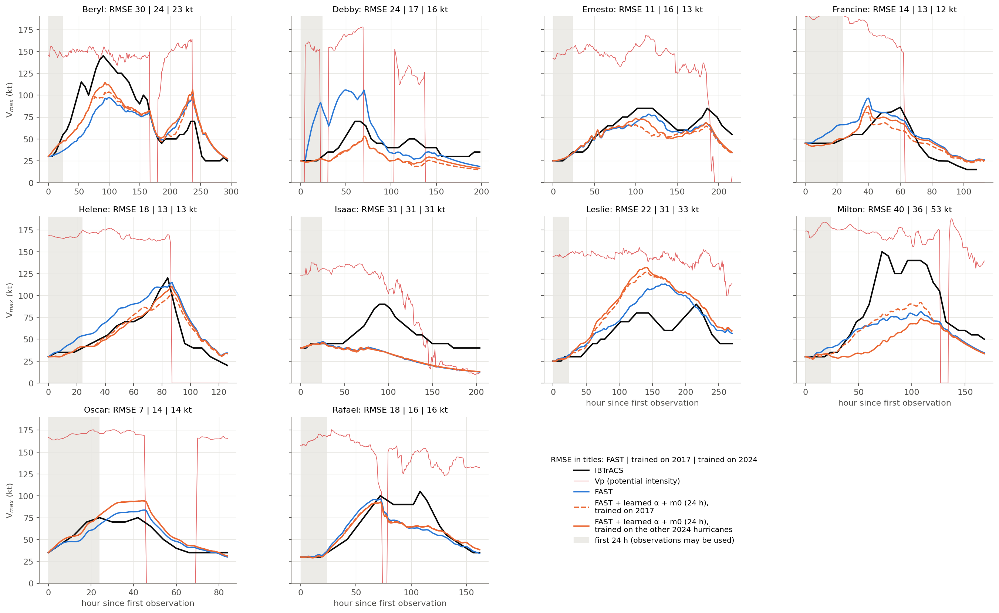
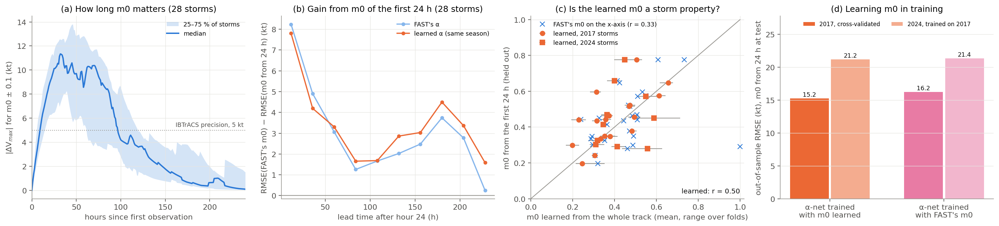
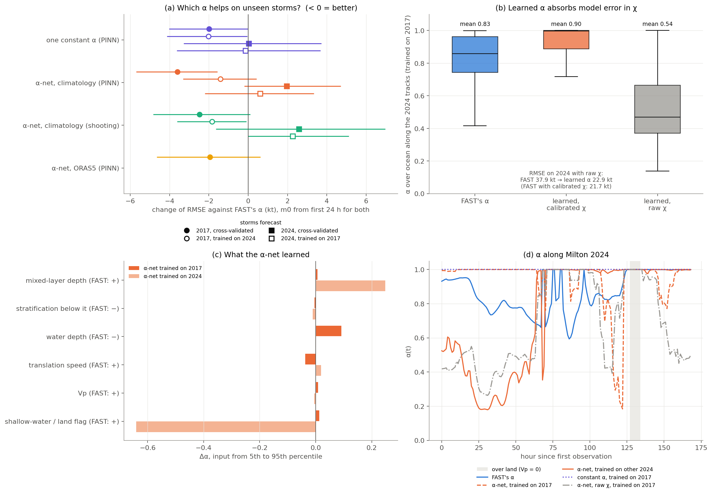
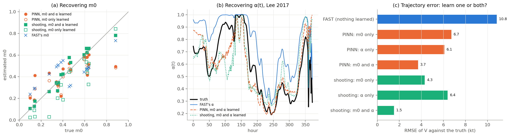
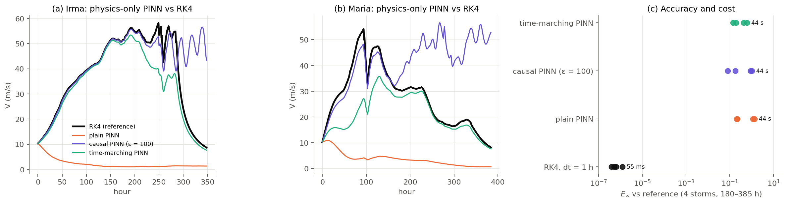

# Learning m0 and α for the FAST hurricane model: does it help?

**CSE 7752 final project, Team 4** — Shijie (Jay) Xiao, Achyutan Narayanan,
Yolanda Li, Nick Wong.

FAST (Emanuel 2017) predicts hurricane intensity from two ODEs. Two of its
quantities cannot be observed directly:

- **m0**, the initial inner-core moisture of each storm;
- **α(t)**, the ocean-coupling (cold-wake) factor along the track.

FAST computes both from fixed formulas. Here they are **learned** from IBTrACS
intensities: m0 per storm, and α(t) = g_φ(o(t)) by one neural network shared
by all storms, driven by ocean inputs o(t) along the track. Two estimators
are compared: a physics-informed neural network (**PINN**) and classical
**shooting** through a differentiable RK4 solver. The learned values are then
put back into the unchanged FAST model.

**The question of this repository:** *do the learned m0 and α make FAST
better on storms it was not trained on, and are the learned values
meaningful?*

## Answer in short

RMSE of V_max against IBTrACS after hour 24, in kt, mean over storms. Every
storm is forecast by a calibration that never saw it
(`results/exp1_skill_summary.csv`):

| storms forecast | calibration trained on | FAST | FAST + learned α + m0 (24 h) | change, 95 % interval | storms improved |
|---|---|---|---|---|---|
| 2017 (18 storms) | the other 2017 storms | 22.8 | **15.3** | **−7.5** [−10.8, −4.6] | 18 / 18 |
| 2017 (18 storms) | the 2024 hurricanes | 22.8 | **17.4** | **−5.3** [−8.7, −2.4] | 16 / 18 |
| 2024 (10 hurricanes) | the other 2024 hurricanes | 21.7 | 22.6 | +0.9 [−3.1, +5.2] | 6 / 10 |
| 2024 (10 hurricanes) | the 2017 storms | 21.7 | 21.2 | −0.5 [−3.5, +2.9] | 6 / 10 |

1. **Do the learned values make FAST better?** On the 2017 storms, yes:
   23–33 % lower error, significant, whichever season the calibration was
   trained on. On the 2024 hurricanes, no: the change is within ±1 kt and
   not significant, again whichever season was used for training. So the
   outcome depends on which storms are forecast, not on whether the training
   storms come from the same season. The large 2024 errors are of a kind
   m0 and α cannot remove: rapid intensification far above FAST (Milton,
   Beryl), no intensification at all in FAST (Isaac), over-intensification
   (Leslie) (Experiment 2). Even in-sample, FAST + learned α + m0 fits the
   2024 hurricanes only to 15–16 kt, against 12–13 kt for the 2017 storms
   (`calibration_runs.csv`).
2. **Is the learned m0 useful?** Yes, as an initial condition. Fitting m0 to
   the first 24 h alone lowers the error by 3.9 kt on 2017 and 1.0 kt on
   2024, mostly in the first two forecast days (8 kt in the first 24 h); a
   change of m0 is felt for about four days. The m0 learned from a whole
   track agrees only moderately with the m0 from its first 24 h (r = 0.50;
   FAST's m0: r = 0.33), so m0 is partly a storm property and partly a
   fitting parameter (Experiment 3).
3. **Is the learned α useful, and is it ocean physics?** It is useful as a
   correction, not as ocean physics (Experiment 4).
   - One constant α does as well as the α-network on storms of another
     season. The learned constant is at or next to its upper bound α = 1
     (no cold-wake damping): 0.97–1.00 in all 13 calibrations. The α-network is ≈ 1
     at most hours (median 0.998 against FAST's 0.86). What is learned is
     mainly that FAST's ocean damping is too strong for these storms.
   - α absorbs errors elsewhere in FAST: with raw χ, FAST's 2024 error is
     37.9 kt. α learned on 2017 drops to a mean of 0.54 and brings the error
     to 22.9 kt, as good as FAST's own χ calibration (21.7 kt).
   - The α-networks trained on 2017 and on 2024 respond to different ocean
     inputs, partly with signs opposite to FAST's formula. ORAS5 inputs are
     not better than climatology.
4. **PINN or shooting?** The same forecast skill within 1–2 kt. Shooting is
   3–8× cheaper and recovers a known m0 and α better in the twin
   experiment (Experiment 5). As a plain solver of FAST, the PINN is far less
   accurate than RK4 and only works with time marching (Experiment 6).
5. **No leakage.** A forecast storm is never in the training set, its m0
   uses only its first 24 h, and only t > 24 h is scored; the tests in
   `tests/test_fastpinn.py` check this.

## What is where

| path | content |
|---|---|
| `fast/fast_equations.py` | The FAST equations (NumPy): right-hand side, Jacobian, initial moisture, FAST's χ calibration |
| `fast/wind_conversion.py` | FAST's conversion between the azimuthal-mean wind V and the maximum wind V_max |
| `fastpinn/physics.py` | The same FAST equations in PyTorch, differentiable RK4, observation operator |
| `fastpinn/networks.py` | `TrajectoryNet` (PINN surrogate of V, m with hard initial conditions), `AlphaNet` (g_φ) |
| `fastpinn/calibrate.py` | PINN and shooting estimators, their losses and training loops |
| `fastpinn/forecast.py` | Training a calibration (`fit`) and the forecast protocol (`assimilate_m0`, `forecast`) |
| `fastpinn/data.py`, `fastpinn/config.py` | Data loading, ocean inputs, all settings |
| `experiments/run_calibrations.py` | Step 0: fits m0 and α on every train/test split (the only expensive step) |
| `experiments/exp1_forecast_skill.py` … `exp6_pinn_solver.py` | One experiment per question, one figure each |
| `results/` | All numbers, as CSV (see [Result files](#result-files-for-the-report)) |
| `figures/` | `fig1` … `fig6`, one per experiment |
| `data/storms/2017/`, `data/storms/2024/` | Hourly FAST inputs and IBTrACS, one CSV per storm |
| `scripts/` | Rebuild the data: FAST inputs, ocean climatology, ORAS5 |
| `tests/test_fastpinn.py` | Physics, data, and no-leakage checks of the forecast protocol |

## Data

| season | storms | role |
|---|---|---|
| 2017 | all 18 North Atlantic storms of the FAST training data | 6-fold cross-validation; training set for the 2024 test |
| 2024 | the 10 North Atlantic hurricanes of FAST-ML's 2024 archive (Beryl, Debby, Ernesto, Francine, Helene, Isaac, Leslie, Milton, Oscar, Rafael) | 5-fold cross-validation; training set for the 2017 test |

Each storm CSV holds the hourly FAST inputs along the IBTrACS track (α, β, γ,
Vp, χ, S, position) and the IBTrACS maximum wind (`v_obs`, m/s, 6-hourly,
interpolated to the hour). Runs start at the first IBTrACS record.

**Ocean inputs o(t)** of the α-network:

- **climatology** (default, both seasons): FAST's own α inputs from FHLO's
  monthly climatology (mixed-layer depth, stratification below it, water
  depth), plus translation speed, Vp and a shallow-water/land flag.
- **ORAS5** (2017 only): SST, mixed-layer depth, T100, D26 and TCHP from the
  ORAS5 ocean reanalysis for the actual month, plus the same motion/Vp/land
  inputs. The open ORAS5 archive ends in 2018, so it cannot be used for 2024.
- **none**: no inputs, so the network is one constant α (a control).

## Model and methods

$$
\dot V=\kappa\left[\alpha\beta V_p^2m^3-(1-\gamma m^3)V^2\right],\qquad
\dot m=\kappa\left[(1-m)V-\chi S\,m\right],\qquad \kappa=\frac{C_k}{2h}\cdot 3600
$$

- **FAST as it is used operationally.** κ = 1.543·10⁻³ (m/s)⁻¹ h⁻¹; the
  forcing of hour k is constant on [k, k+1); χ is calibrated as in FAST
  (tropical_cyclone_risk / FHLO): χ_eff = exp(log(χ + 10⁻³) + 0.5) + 1.3,
  capped at 5. The modelled V is converted to V_max with FAST's translation
  asymmetry (`axi_to_max_wind`); the shear term is not used, the same for
  both seasons.
- **What is learned.** m0 = sigmoid(ρ) per storm, and α(t) = g_φ(o(t)) ∈
  [0.13, 1], one network for all storms. When α changes, γ = ε + kα changes
  consistently (`fastpinn/data.py: thermo_split`).
- **PINN.** A trajectory network (V̂, m̂)(t) with hard initial conditions
  V̂(0) = V0, m̂(0) = m0 is fitted to the observations while the FAST
  residual is penalised:
  L = L_obs + L_phys + 10⁻³‖α − α_FAST‖² + bound penalty.
  It is trained with **time marching**: the trained window grows from 5 % to
  100 % of each storm over the first half of the iterations (4000 Adam
  iterations). Without it the PINN collapses to V = m = 0 (Experiment 6).
- **Shooting.** The same m0 and g_φ, fitted through a differentiable RK4
  integration of FAST (L_obs + prior, 300 Adam iterations).
- **Forecast protocol (no leakage).** A storm is only ever scored by a
  calibration that did not see it. For such a storm, α(t) comes from the
  frozen network, and m0 is either FAST's or fitted to the observations of
  the **first 24 h only**. FAST is then run from the first observation, and
  only **t > 24 h** is scored. Tests in `tests/test_fastpinn.py` check that
  no split trains on a test storm, that m0 does not change when the
  observations after hour 24 change, and that the physics-only PINN does
  not see the observations.
- **Four evaluations** (column `evaluation` in all result files):

  | `evaluation` | storms forecast | trained on |
  |---|---|---|
  | `cv2017` | 18 storms of 2017, in 6 folds of 3 | the other 15 storms of 2017 |
  | `cv2024` | 10 hurricanes of 2024, in 5 folds of 2 | the other 8 hurricanes of 2024 |
  | `2017to2024` | 10 hurricanes of 2024 | all 18 storms of 2017 (another season) |
  | `2024to2017` | 18 storms of 2017 | all 10 hurricanes of 2024 (another season) |

  Folds: storms sorted by peak intensity and dealt round-robin. The first
  two evaluations forecast storms of the training season, the last two a
  season the calibration has never seen, which is how a calibrated FAST
  would be used for a future season.

## Experiments

Experiments 1–4 only read the calibrations of `run_calibrations.py`;
Experiments 5 and 6 run on their own. All RMSEs are of V_max against
IBTrACS after hour 24 (kt). "m0 (24 h)" means m0 fitted to the first 24 h of
observations of the forecast storm.

### 1. Does learning m0 and α improve FAST on unseen storms?

`experiments/exp1_forecast_skill.py` → `figures/fig1_forecast_skill.png`,
`results/exp1_skill_*.csv`



(a) Change of each storm's RMSE against FAST, averaged over the storms, with
a 95 % bootstrap interval over storms (paired: the same storms with and
without learning). (b) The same change per storm for the main configuration,
trained on the same season (x) against trained on the other season (y).

Mean RMSE (kt):

| configuration | 2017, cross-validated | 2017, trained on 2024 | 2024, cross-validated | 2024, trained on 2017 |
|---|---|---|---|---|
| FAST | 22.8 | 22.8 | 21.7 | 21.7 |
| FAST + m0 (24 h) | 18.9 | 18.9 | 20.6 | 20.6 |
| FAST + learned α | 18.5 | 21.1 | 24.5 | 22.9 |
| FAST + learned α + m0 (24 h) | **15.3** | **17.4** | 22.6 | 21.2 |
| same, α trained by shooting | 16.4 | 17.0 | 23.2 | 22.9 |
| FAST with raw χ (old baseline) | 37.5 | 37.5 | 37.9 | 37.9 |

- On the 2017 storms every learned configuration beats FAST, and learning α and m0
  together is best (18/18 storms better when trained on 2017, 16/18 when
  trained on 2024).
- On the 2024 hurricanes nothing beats FAST significantly. Learned α alone
  makes 2024 worse (+1.3 to +2.9 kt).
- In (b) the points lie near the diagonal: a storm gains about the same
  whichever season the calibration was trained on. Whether learning helps is
  a property of the storm, not of matching seasons.
- FAST with raw (uncalibrated) χ is 15 kt worse than FAST. Comparing
  against it would inflate the gain of learning; all comparisons here use
  FAST's own χ calibration.

### 2. The 2024 hurricanes, storm by storm

`experiments/exp2_hurricanes_2024.py` → `figures/fig2_hurricanes_2024.png`,
`results/exp2_hurricanes_2024.csv`



V_max of FAST and of FAST + learned α + m0 (24 h), trained on 2017 (dashed)
or on the other 2024 hurricanes (solid), against IBTrACS; Vp in red. The
titles give the three RMSEs.

- Improved: Beryl (30 → 24 / 23 kt), Debby (24 → 17 / 16), Helene
  (18 → 13 / 13), Francine, Rafael.
- Worse: Leslie (22 → 31 / 33), Oscar (7 → 14 / 14), Ernesto, and Milton when
  trained on 2024 (40 → 53).
- What no m0 or α can fix: Milton and Beryl intensify far faster and higher
  than FAST can, Isaac stays weak in FAST although Vp is high, and landfalls
  (Vp → 0) end the storms abruptly.

### 3. Is m0 worth learning?

`experiments/exp3_initial_moisture.py` → `figures/fig3_initial_moisture.png`,
`results/exp3_*.csv`



- (a) Memory: changing m0 by ±0.1 changes V_max by up to 11 kt (median,
  hour 32) and by more than the 5 kt IBTrACS precision until hour 96. m0
  is an initial condition with about four days of influence.
- (b) The gain from m0 (24 h) is 8 kt in the first forecast day, 3–5 kt on
  days 2–3, and 1–4 kt later (28 storms, cross-validated).
- (c) The m0 learned from a storm's whole track (as a training storm) and
  the m0 fitted to its first 24 h (when held out) correlate with r = 0.50;
  FAST's m0 with r = 0.33. So the learned m0 carries some storm information
  but also absorbs other errors.
- (d) Learning m0 during training helps the α-network a little: 15.3 vs
  16.2 kt on 2017, 21.2 vs 21.4 kt on 2024.

### 4. Is the learned α useful, and is it physical?

`experiments/exp4_ocean_coupling.py` → `figures/fig4_ocean_coupling.png`,
`results/exp4_*.csv`



(a) Change of RMSE against FAST's own α, m0 (24 h) for both, 95 % interval
(kt):

| α source | 2017, cross-validated | 2017, trained on 2024 | 2024, cross-validated | 2024, trained on 2017 |
|---|---|---|---|---|
| one constant α | −2.0 [−4.0, 0.0] | −2.0 [−4.1, −0.1] | 0.0 [−3.3, +3.7] | −0.1 [−3.6, +3.7] |
| α-net, climatology (PINN) | −3.6 [−5.7, −1.6] | −1.4 [−3.3, +0.4] | +2.0 [−0.2, +4.7] | +0.6 [−2.2, +3.4] |
| α-net, climatology (shooting) | −2.5 [−4.8, +0.1] | −1.8 [−3.6, −0.1] | +2.6 [−1.6, +7.0] | +2.3 [0.0, +5.1] |
| α-net, ORAS5 (PINN) | −1.9 [−4.7, +0.6] | | | |

- Across seasons one constant α is as good as the α-network, and the learned
  constant is 0.97–1.00 (no cold-wake damping) in all 13 calibrations. Only
  within 2017 does the α-network beat the constant (by 1.6 kt).
- (b) Along the 2024 tracks, FAST's α has mean 0.83; the learned α 0.90
  (median 1.0). With raw χ, the learned α drops to 0.54 and makes up for the
  missing ventilation: RMSE 37.9 → 22.9 kt.
- (c) Change of α when one input goes from its 5th to its 95th percentile.
  The network trained on 2017 reacts mainly to water depth (+0.09, FAST's
  formula: −) and translation speed (−0.04, FAST: +). The one trained on 2024
  reacts to mixed-layer depth (+0.25, FAST: +) and the shallow/land flag
  (−0.64). The two do not agree: the network does not learn a robust ocean
  response from 10–18 storms.
- (d) α along Milton 2024: FAST's α, the two α-networks, the constant α, and
  α learned with raw χ.

### 5. Twin experiment: can a known m0 and α be recovered?

`experiments/exp5_twin_recovery.py` → `figures/fig5_twin_recovery.png`,
`results/exp5_*.csv`



On the real tracks and forcing of the 18 storms of 2017, a truth is set:
m0 = FAST's m0 ± 0.15, and α = 1 − 0.87 exp(−0.4 z) instead of FAST's
1 − 0.87 exp(−z) (z: FAST's ocean-mixing parameter). Synthetic observations:
FAST with the truth, as V_max, + N(0, 1 m/s) noise, every 6 h.

| learned | m0 error (MAE) | α error over ocean (RMSE) | V error against truth (kt) | wall (s) |
|---|---|---|---|---|
| nothing (FAST) | 0.149 | 0.212 | 10.8 | – |
| PINN: m0 only | 0.100 | 0.212 | 6.7 | 1810 |
| PINN: α only | 0.149 | 0.195 | 6.1 | 1930 |
| PINN: m0 and α | 0.098 | 0.169 | 3.7 | 2110 |
| shooting: m0 only | 0.104 | 0.212 | 4.3 | 238 |
| shooting: α only | 0.149 | 0.226 | 6.4 | 305 |
| shooting: m0 and α | **0.036** | **0.150** | **1.5** | 301 |

- When the model is right, learning both recovers the truth, best with
  shooting.
- Learning only one quantity makes it compensate for the other: with m0
  fixed at the wrong value, the learned α moves *away* from the truth
  (shooting, α only: 0.226 > 0.212).

### 6. The PINN as a solver of FAST

`experiments/exp6_pinn_solver.py` → `figures/fig6_pinn_solver.png`,
`results/exp6_pinn_solver.csv`



No observations: m0 and α are fixed at FAST's, and only the PINN's
trajectory network is trained, with the FAST residual alone (the same
network and 4000 iterations as in the calibrations). The error is
E∞ = max_t ‖((V − V_ref)/V*, m − m_ref)‖ against RK4 with dt = 1/16 h, on
Irma, Maria, Nate and Ophelia 2017 (180–385 h).

| solver | E∞ (4 storms) | wall (4 storms) |
|---|---|---|
| RK4, dt = 1 h | 4·10⁻⁷ – 1.2·10⁻⁶ | 0.055 s |
| plain PINN | 0.21 – 1.36 | 44 s |
| causal PINN (ε = 100) | 0.08 – 1.04 | 44 s |
| time-marching PINN (used in all calibrations) | 0.14 – 0.61 | 44 s |

- The plain PINN collapses to the trivial solution V ≈ 0 on long storms.
- Causal weighting follows the first part of the track and then drifts.
  Time marching is the most robust, but it still misses peaks and the
  sudden Vp changes (landfall, track over cold water).
- As a solver of FAST the PINN is 5–6 orders of magnitude less accurate than
  RK4 and about 800 times slower. Its role here is only as an estimator of
  m0 and α, where the observations hold the trajectory in place.

## Result files for the report

All in `results/`, plain CSV. Wind speeds in kt.

| file | one row per | main columns |
|---|---|---|
| `storms.csv` | storm-hour | `season, storm, hour, lat, lon, obs_kt` (IBTrACS, 6-hourly), `vp_kt`, `alpha_fast`, `scored` (t > 24 h with an observation) |
| `forecasts.csv` | storm-hour per configuration | `split, evaluation, season, storm, variant, m0_source, hour, vmax_kt` |
| `learned_m0.csv` | storm per calibration | `split, evaluation, variant, storm, role` (train: learned from the whole track; test: from the first 24 h), `m0, m0_fast` |
| `learned_alpha.csv` | storm-hour per calibration | α(t) along every test track: `split, evaluation, variant, storm, hour, alpha` |
| `calibration_runs.csv` | calibration | `split, variant, n_train, wall_s, train_rmse_kt` (in-sample) |
| `calibrations/<split>__<variant>.pt` | calibration | trained α-network, feature scaler, training m0 (PyTorch) |
| `exp1_skill_by_storm.csv` | storm per configuration | `rmse_kt, bias_kt, peak_err_kt` over t > 24 h |
| `exp1_skill_summary.csv` | evaluation per configuration | mean RMSE, bias, peak error, `storms_better_than_fast`, `rmse_change_vs_fast_kt` with `ci95_low_kt, ci95_high_kt` |
| `exp1_skill_by_lead.csv` | evaluation, configuration, 24 h lead bin | pooled RMSE by lead time |
| `exp2_hurricanes_2024.csv` | 2024 storm-hour | IBTrACS, Vp, FAST, FAST + learned α and m0 trained on 2017 / on 2024 |
| `exp3_m0_memory.csv` | hour | how much V_max changes for m0 ± 0.1 |
| `exp3_m0_gain_by_lead.csv` | lead bin | RMSE with FAST's m0 and with m0 from the first 24 h |
| `exp3_m0_consistency.csv` | storm | m0 learned from the whole track vs from the first 24 h |
| `exp3_m0_in_training.csv` | evaluation | α-net trained with / without learning m0 |
| `exp4_alpha_skill.csv` | evaluation per α source | RMSE change against FAST's α, 95 % interval |
| `exp4_alpha_values.csv` | α source | distribution of α over ocean on the 2024 tracks |
| `exp4_alpha_response.csv` | α-net input | Δα from the 5th to the 95th percentile of the input |
| `exp4_alpha_example.csv` | hour | α(t) along Milton 2024 |
| `exp5_twin_summary.csv`, `exp5_twin_m0.csv`, `exp5_twin_alpha_example.csv` | | twin experiment |
| `exp6_pinn_solver.csv` | storm per solver | E∞ against RK4 and wall time |

Configurations (`variant` × `m0_source`):

| `variant` | what was learned in training | evaluations |
|---|---|---|
| `fast` | nothing: FAST's α (baseline) | all |
| `fast_rawchi` | nothing, and FAST with raw χ (for comparison only) | all |
| `pinn_joint` | PINN: m0 per storm and the α-network (climatology inputs) — **the main method** | all |
| `shooting_joint` | shooting: the same | all |
| `pinn_constant_alpha` | PINN: m0 and one constant α (control: no ocean information) | all |
| `pinn_alpha_only` | PINN: the α-network with m0 fixed at FAST's | `cv2017`, `2017to2024` |
| `pinn_joint_oras5` | PINN: m0 and the α-network on ORAS5 inputs | `cv2017` |
| `pinn_joint_rawchi` | PINN: as `pinn_joint`, but FAST with raw χ | `2017to2024` |

| `m0_source` | m0 of the forecast storm |
|---|---|
| `prior` | FAST's own m0 |
| `first24h` | fitted to the IBTrACS observations of its first 24 h (α frozen) |

## Reproduce

```bash
pip install -r requirements.txt
python experiments/run_all.py           # everything, about 2.5 h on a 24-core CPU
python experiments/run_all.py 1 2 3 4   # only re-analyse the saved calibrations (seconds)
python -m pytest -q tests
```

`run_calibrations.py` runs its 53 fits in 12 processes; with fewer cores use
`python experiments/run_calibrations.py --workers 4`.

Rebuilding the inputs:

```bash
python scripts/extract_fast_inputs.py --src "<path>/FAST/training_data" --out data/storms/2017
python scripts/add_ocean_inputs.py --fhlo <path to an FHLO clone> --data data/storms/2017
python scripts/add_ocean_inputs.py --fhlo <path to an FHLO clone> --data data/storms/2024
python scripts/add_oras5_inputs.py      # 2017 only; downloads ORAS5 into data/oras5/
```

The 2024 CSVs come from FAST-ML's released 2024 archive via the EAS 6130
repository's `scripts/extract_fast_inputs.py`.

## Limitations

- **Small samples.** 18 storms in 2017 and 10 in 2024. Differences of 1–2 kt
  between configurations are within the storm-to-storm spread; use the 95 %
  intervals in `exp1_skill_summary.csv` before calling a difference real.
- **Observation precision.** IBTrACS intensities are reported in 5 kt steps
  and interpolated to the hour; errors below ~5 kt are not meaningful.
- **α is not uniquely identified.** α multiplies the potential-intensity
  term, so it absorbs any error in that term (χ, Vp, the V→V_max conversion).
  The learned α is an *effective* coupling, not a measurement of the cold
  wake (Experiment 4b shows this with raw χ).
- **Same FAST everywhere.** Shear is not in the observation operator for
  either season, and κ, χ calibration and the V→V_max conversion are FAST's.
  Learning m0 and α cannot fix errors with other causes (e.g. landfall
  timing, rapid intensification driven by the inner core).
- **α is bounded to [0.13, 1].** The learned constant α sits at the upper
  bound, so the data may want even more intensification than α = 1 allows.
  The missing intensity is not an ocean effect and α cannot supply it.
- **ORAS5 only for 2017**, so the ORAS5 α-net is tested by cross-validation
  only.
- **Wall-clock times** in `calibration_runs.csv` were measured with 12 fits
  running in parallel; compare them only within one run.
- **Cold start.** Runs start at the first IBTrACS record with V0 from it;
  m0 from the first 24 h needs those 24 h of observations before the
  forecast starts.
