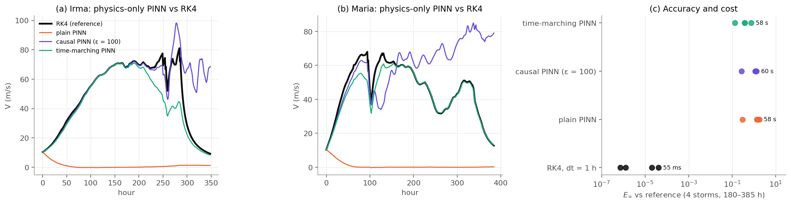
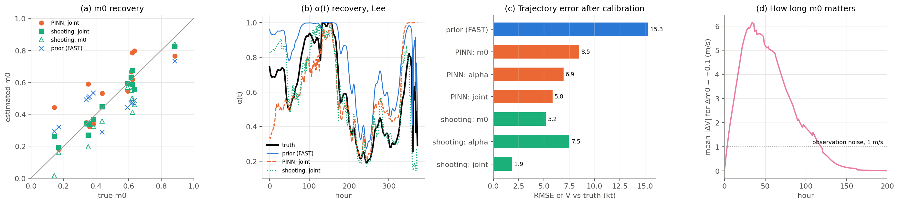
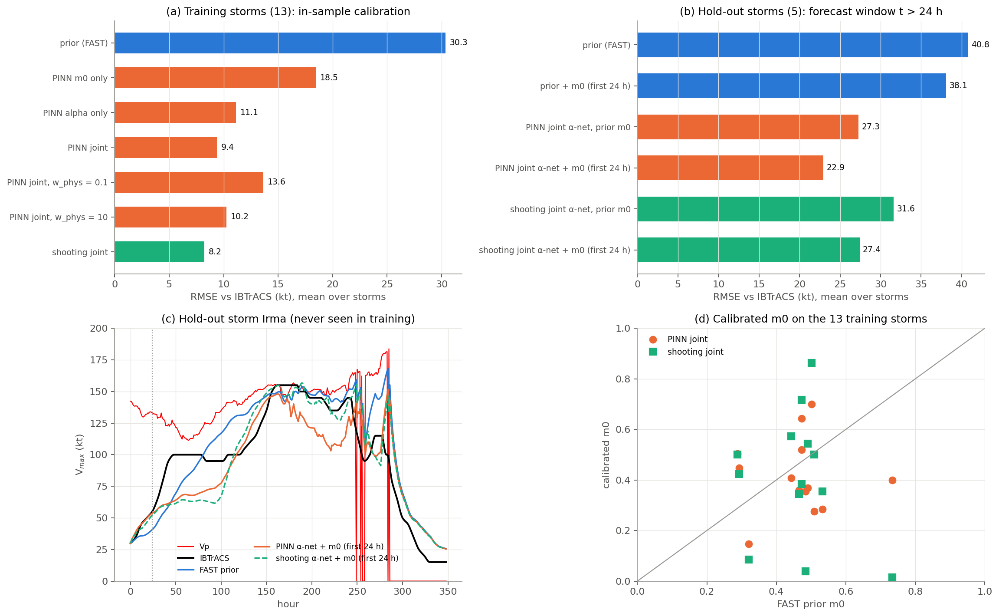

# Latent Parameterization of the FAST Hurricane Model

**CSE 7752 final project, Team 4** — Shijie (Jay) Xiao, Achyutan Narayanan,
Yolanda Li, Nick Wong.

A physics-informed neural network (PINN) infers two quantities that FAST
cannot observe directly:

- the initial inner-core moisture **m0** of each storm;
- the ocean-coupling (cold-wake) factor **α(t) = g_φ(o(t))**, one network
  shared by all storms and driven by along-track ocean and storm-motion
  inputs o(t).

The calibrated m0 and α(t) are then passed to the FAST ODE solver. The
physics is exactly FAST (the same equations, data and wind conversion as the
companion EAS 6130 repository); only m0 and α are learned.

## Proposal → code

| proposal item | where |
|---|---|
| FAST ODEs as the physical backbone | `fast/fast_equations.py` (NumPy), `fastpinn/physics.py` (PyTorch, same equations) |
| PINN with hard initial conditions V̂(0) = V0 (fixed) and m̂(0) = m0 (trainable, in (0, 1)) | `fastpinn/networks.py: TrajectoryNet`, `fastpinn/calibrate.py: PINNCalibrator` |
| α(t) = g_φ(o(t)) from ocean inputs, shared across storms, physical range [0.13, 1] | `fastpinn/networks.py: AlphaNet` |
| L = w_obs L_obs + w_phys L_phys (+ prior near FAST defaults, + bound penalty) | `fastpinn/calibrate.py` |
| Observation operator: modelled azimuthal-mean wind → IBTrACS maximum wind | `fastpinn/physics.py: obs_operator` (FAST's `axi_to_max_wind`) |
| V* normalisation | `fastpinn/config.py: V_STAR` |
| Comparison with classical calibration (numerical shooting through RK4) | `ShootingCalibrator` |
| Twin experiments with known m0 and α; separate vs joint calibration (compensation) | `experiments/exp2_twin.py` |
| Hold-out evaluation: trajectory RMSE, peak intensity, peak timing, peak location along track | `experiments/exp3_real_storms.py`, `fastpinn/evaluate.py` |
| Tuning w_obs / w_phys | `exp3` (w_phys = 0.1, 1, 10) |
| PINN as an alternative solver, separated from calibration | `experiments/exp1_pinn_solver.py` |
| Admissibility checks (V ≥ 0, 0 ≤ m ≤ 1) of the resulting FAST solutions | `fastpinn/evaluate.py` |

## Model

$$
\dot V=\kappa\left[\alpha\beta V_p^2m^3-(1-\gamma m^3)V^2\right],\qquad
\dot m=\kappa\left[(1-m)V-\chi S\,m\right]
$$

- **Exchange rate.** κ = C_k/(2h)·3600 = 1.543·10⁻³ (m/s)⁻¹ h⁻¹, with t in
  hours.
- **Hourly forcing.** As in FAST, the forcing of hour k is constant on
  [k, k+1).
- **Thermodynamic coefficients.** β = 1 − ε − k and γ = ε + αk. FAST's data
  give α, β and γ; since β + γ = 1 − k(1 − α), the moisture term k ≈ 0.12 is
  recovered wherever α < 1 (`fastpinn/data.py: thermo_split`). When the
  network changes α, γ(α) = ε + kα stays thermodynamically consistent, and it
  equals the data's γ exactly at FAST's α.
- **Initial wind.** V0 is the first IBTrACS wind inverted to the azimuthal
  mean with FAST's conversion, and held fixed. FAST's prior m0 is its usual
  inversion of Eq. (1).
- **Ocean inputs o(t).** These are the quantities FAST's α formula is built
  from: log mixed-layer depth, log stratification, log water depth,
  translation speed, Vp, and a shallow-water/land flag. They come from FHLO's
  monthly ocean climatology (`scripts/add_ocean_inputs.py`).

## Data

The data are 18 North Atlantic storms of 2017 (the FAST training data,
`*_dataset.pkl`): hourly ERA5-derived inputs along the IBTrACS track. The
same CSVs are used in the EAS 6130 repository. 13 storms are used for
training; 5 are held out (Harvey, Irma, Maria, Nate, Ophelia). Observations
are the 6-hourly IBTrACS intensities.

## Methods

| estimator | what is optimised | loss |
|---|---|---|
| **PINN** | trajectory network (V̂, m̂)(t), m0, α-network g_φ | w_obs L_obs + w_phys L_phys + w_prior ‖α − α_FAST‖² + bound penalty |
| **Shooting** (classical baseline) | m0, α-network g_φ | w_obs L_obs (+ prior) through a differentiable RK4 integration of FAST |

The loss terms are defined as follows (t in hours):

- **Observation loss.** L_obs = mean over the 6-hourly IBTrACS times of
  ((H(V̂) − y)/V*)², where H is FAST's conversion to V_max.
- **Physics loss.** L_phys = mean over collocation points of
  (r_V T*/V*)² + (r_m T*)², where r is the FAST residual and T* = 1/(κV*).
- **Training.** The α-network is warm-started on FAST's α (the physics
  prior). The PINN uses a time-marching curriculum (Experiment 1 shows why).
  w_obs = 1, w_phys = 1 and w_prior = 10⁻³ unless stated.
- **Evaluation.** After calibration, every result is produced by the FAST ODE
  solver (RK4, 15 min) with the calibrated m0 and α(t), never by the PINN
  trajectory. All metrics are computed on V_max against IBTrACS.

## Results

`python experiments/run_all.py` runs everything in about 25 min on a laptop
CPU. Results are written to `results/` and figures to `figures/`.

### 1. The PINN as a FAST solver — `exp1_pinn_solver.py`

Here m0 and α are fixed at FAST's values, and only the physics residual is
trained, on 4 storms of 180–385 h.

| solver | E∞ vs converged RK4 | cost |
|---|---|---|
| RK4, dt = 1 h | 7·10⁻⁷ – 4·10⁻⁵ | 55 ms |
| plain PINN | 0.30 – 1.78 | 58 s |
| causal PINN (ε = 100) | 0.27 – 1.34 | 60 s |
| time-marching PINN | 0.13 – 0.77 | 58 s |

- **Plain PINN.** It collapses onto FAST's trivial equilibrium V = m = 0,
  which satisfies the ODE everywhere except right after t = 0.
- **Causal weighting.** It prevents the collapse but drifts after the first
  sharp event.
- **Time marching.** It follows the solution over long stretches but not
  through landfall.

**Conclusion.** As a forward solver for long, forcing-driven trajectories,
the PINN is ~1000× slower and 4–5 orders of magnitude less accurate than
RK4. Its value lies in calibration, where data constrain the trajectory.



### 2. Twin experiments: recovery and compensation — `exp2_twin.py`

Synthetic observations come from a known truth on the 13 training tracks:
m0 = prior ± 0.15, and α with a stronger cold wake than FAST. Noise is
1 m/s, every 6 h.

| calibration | m0 error (MAE) | α error (RMSE, ocean) | V error vs truth (kt) |
|---|---:|---:|---:|
| none (FAST prior) | 0.150 | 0.199 | 15.3 |
| PINN: m0 only | **0.049** | 0.199 (fixed) | 8.5 |
| PINN: α only | 0.150 (fixed) | 0.216 | 6.9 |
| PINN: joint | 0.098 | 0.183 | 5.8 |
| shooting: m0 only | 0.084 | 0.199 (fixed) | 5.2 |
| shooting: α only | 0.150 (fixed) | 0.174 | 7.5 |
| shooting: joint | **0.039** | **0.127** | **1.9** |

- **Compensation is real.** Calibrating one quantity alone leaves 5–8 kt
  error, because the free parameter absorbs the error of the fixed one.
  For example, shooting with m0 only fits better (5.2 kt) than with α only,
  but with a biased m0 (error 0.084). Only joint calibration approaches the
  truth.
- **m0 is weakly identifiable.** A change of 0.1 in m0 moves V by up to
  6 m/s around hour 35, but by less than the 1 m/s noise after about 120 h
  (panel d). Only the first few days of observations constrain it, which
  confirms Reviewer 4's remark.
- **The shooting baseline recovers the truth best on twin data.** It
  integrates the exact model, while the PINN satisfies the physics only
  approximately.



### 3. Real storms: calibration and hold-out prediction — `exp3_real_storms.py`

**Training storms (13), in-sample, V_max vs IBTrACS:**

| method | RMSE (kt) | bias (kt) | abs. peak error (kt) | abs. peak timing (h) | calibration time |
|---|---:|---:|---:|---:|---:|
| FAST prior | 30.3 | +23.3 | 39.3 | 34 | – |
| PINN m0 only | 18.5 | +7.9 | 18.7 | 34 | 104 s |
| PINN α only | 11.1 | +4.5 | 7.2 | 24 | 109 s |
| **PINN joint** (w_phys = 1) | **9.4** | +3.3 | **5.7** | 24 | 112 s |
| PINN joint, w_phys = 0.1 | 13.6 | +7.8 | 9.6 | 29 | 111 s |
| PINN joint, w_phys = 10 | 10.2 | −2.2 | 8.1 | 15 | 111 s |
| **shooting joint** | **8.2** | −0.3 | 6.4 | 23 | 90 s |

**Hold-out storms (5, never seen in training), forecast window t > 24 h:**

| method | RMSE (kt) | abs. peak error (kt) | abs. peak timing (h) |
|---|---:|---:|---:|
| FAST prior | 40.8 | 36.0 | 46 |
| FAST prior, m0 from first 24 h | 38.1 | 34.2 | 44 |
| shooting α-net, prior m0 | 31.6 | 30.3 | 18 |
| shooting α-net + m0 from first 24 h | 27.4 | 27.2 | 18 |
| PINN α-net, prior m0 | 27.3 | 17.6 | 17 |
| **PINN α-net + m0 from first 24 h** | **22.9** (−44 %) | **15.4** | **17** |

Per storm (RMSE, FAST prior → PINN α-net + m0 from 24 h):

| storm | FAST prior (kt) | PINN α-net + m0 (kt) |
|---|---:|---:|
| Harvey | 67 | 37 |
| Nate | 64 | 31 |
| Maria | 31 | 15 |
| Ophelia | 20 | 11 |
| Irma | 22 | 22 |

- **FAST's ocean coupling is too weak on these storms.**
  - The calibrated α averages 0.52–0.59, against FAST's 0.89.
  - α alone removes most of the error (11.1 kt), while m0 alone does not
    (18.5 kt).
  - FAST over-intensifies (bias +23 kt), and a stronger cold-wake feedback
    is the dominant correction.
  - When α is frozen, m0 compensates by dropping to 0.23 on average.
- **The physics weight matters.**
  - w_phys = 0.1 under-uses the ODE and the result drifts (13.6 kt).
  - w_phys = 10 over-constrains the fit (10.2 kt).
  - w_phys = 1 is best.
- **The learned α generalises.** On unseen storms the α-network alone cuts
  the error from 40.8 to 27.3 kt. Re-estimating m0 alone barely helps
  (38.1 kt). Together they reach 22.9 kt.
- **PINN vs shooting.** The PINN-trained α-network generalises better than
  the shooting-trained one (22.9 vs 27.4 kt), although shooting fits the
  training storms slightly better (8.2 vs 9.4 kt). A plausible explanation is
  that the residual loss acts as a regulariser on g_φ. With 5 test storms
  this is suggestive, not conclusive.
- **Admissibility.** No calibrated FAST solution violated V ≥ 0 or
  0 ≤ m ≤ 1.



## Limitations

- **Small sample.** There are 18 storms from a single season (2017). Only
  2017 has complete FAST inputs locally; more seasons (2003–2023 as proposed)
  plug in through `scripts/extract_fast_inputs.py`.
- **Ocean inputs are climatological.** o(t) uses monthly climatology (FAST's
  own α inputs), not ORAS5 multi-level fields.
- **The shear asymmetry is zero.** The data have no environmental wind
  vectors, so the observation operator includes the translation asymmetry
  only, exactly as FAST does in that case.
- **α is not uniquely identified.** α also absorbs errors in Vp and in other
  parts of FAST (Reviewer 4, comment 7). The results show better agreement
  with observations, not unique recovery of the true ocean feedback.
- **Cold start.** No observation nudging is used; m0 from the first 24 h is
  the only use of early data in the forecasts.

## Reproduce

```bash
pip install -r requirements.txt
python experiments/run_all.py                       # all experiments, ~25 min on CPU
python experiments/exp3_real_storms.py --figure     # redraw a figure from saved results
python -m pytest -q tests                           # 6 tests
```

To rebuild the inputs:

```bash
python scripts/extract_fast_inputs.py --src "<path>/Project/FAST/training_data"
python scripts/add_ocean_inputs.py --fhlo <path to an FHLO clone>
```
